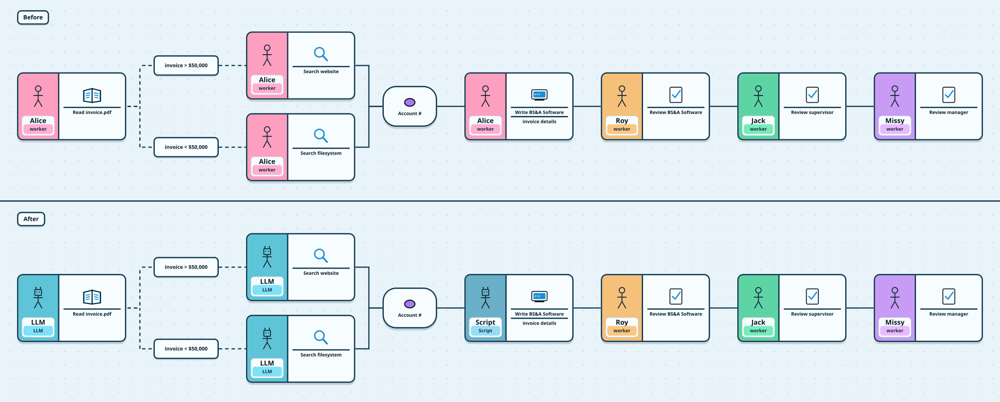

# action-illustrator-render

Recursively scan a repository for `.illustrator` workflow files from [Automation Illustrator](https://github.com/ashfordhill/automation-illustrator) and auto-render them to `.svg` and/or `.png`, fully offline.



Each file renders three views, in the orientation and theme it was exported with:

| File | Shows |
|---|---|
| `flow.svg` | Compare: Before and After together |
| `flow.before.svg` | Before only |
| `flow.after.svg` | After only |

SVGs are vector: tiles, Paths, and chips are shapes, and the Nunito font is embedded, so they look the same on GitHub and offline.

### Inputs

| Input | Description | Required | Default |
|---|---|---|---|
| `format` | Output format: `svg`, `png`, or `both` | No | `svg` |
| `views` | Comma-separated views: `compare`, `before`, `after` | No | `compare,before,after` |
| `scale` | PNG pixels per board pixel | No | `2` |
| `app-image` | Automation Illustrator image that serves `render.html` | No | `ghcr.io/ashfordhill/automation-illustrator:latest` |

`latest` draws with the newest app. Pin a `sha-<commit>` tag of that image when renders should only change when a `.illustrator` file does.

## Workflow example

This workflow triggers on any push that modifies a `.illustrator` file, then commits the rendered output.

```yaml
# .github/workflows/illustrator-render.yml
name: Render Illustrator

on:
  push:
    paths:
      - '**/*.illustrator'

permissions:
  contents: write

jobs:
  render:
    runs-on: ubuntu-latest
    steps:
      - uses: actions/checkout@v4

      - uses: ashfordhill/action-illustrator-render@v1
        with:
          format: 'svg'

      - name: Commit rendered files
        run: |
          git config user.email "github-actions[bot]@users.noreply.github.com"
          git config user.name "github-actions[bot]"
          git add -A
          git diff --staged --quiet || git commit -m "chore: render illustrator files [skip ci]"
          git push
```

## How it works

The action runs the Automation Illustrator Docker image on an isolated Docker network. A renderer container opens the app's `render.html` in headless Chromium (Playwright), passes it each `.illustrator` file, and writes the images next to the original. `render.html` uses the same code as the app's **Export image**, so a render matches an export from the app.

## Local testing

```sh
INPUT_FORMAT=both docker compose run --rm renderer
```

The included `docker-compose.yml` starts both containers locally. The rendered files are written to the current directory.

## Security

- No calls to any external service while rendering.
- No data leaves your runner.
